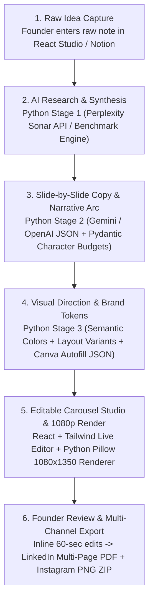

# AI-Powered Founder Carousel Content Creation System

An end-to-end **React + Tailwind CSS + Python (FastAPI & Pillow)** automation system that lets a founder transform a raw 2-sentence thought or voice-note transcript into an **editable, brand-locked 8-slide carousel** for **LinkedIn (multi-page PDF)** and **Instagram (1080×1350 4:5 PNG bundle)** in under 60 seconds—without hiring an in-house graphic designer.

---

## 1. End-to-End Workflow Diagram



---

## 2. AI Tools, Design Platforms & Automation Stack

| Workflow Stage | Cloud / No-Code Option | Code-First Stack (Included in This Repo) | Why This Architecture Works |
| :--- | :--- | :--- | :--- |
| **1. Raw Idea Input** | Notion DB + Wispr Flow | **React + Tailwind Studio** (`src/App.jsx`) | Captures unstructured founder thoughts with 1-click preset loading and IME-safe submission. |
| **2. Research & Angles** | **Perplexity Sonar API** (`sonar-pro`) | `stage_1_research_idea()` in `automation_pipeline.py` | Grounds the founder's opinion in concrete retention metrics, failure rates, and 3 framework pillars. |
| **3. Headlines & Copy** | **Gemini 2.5 Flash/Pro** or **GPT-4o** | `stage_2_generate_slides_and_copy()` + Pydantic `SlideSpec` | Enforces a 6-variant narrative arc and strict character caps (`headline <= 70 chars`) so copy never overflows. |
| **4. Visual Direction & Layout** | **Canva Connect API** (`/v1/autofills`) or Figma Variables | `stage_3_build_canva_and_webhook_mapping()` + 4 Brand Themes | Separates crisp vector/DOM typography from flat AI image generators that hallucinate text. |
| **5. Editable Canvas & Export** | Canva Brand Template + Buffer | **React Editor** + `render_slides.py` (Pillow 1080p PNG/PDF/ZIP) | Lets the founder tweak any slide field in real time and export a native LinkedIn PDF + Instagram PNG ZIP. |

---

## 3. Project Structure & Deliverables

- **`automation_pipeline.py`** — 4-stage Python automation engine (Research -> Copy Structuring -> Visual Tokens & Canva Autofill JSON -> High-Res Asset Rendering). Supports `PERPLEXITY_API_KEY`, `OPENAI_API_KEY`, and `GEMINI_API_KEY` out of the box with deterministic offline fallback.
- **`render_slides.py`** — Pillow-based 1080×1350 (`4:5`) and 1080×1080 (`1:1`) slide renderer that outputs:
  - `/slides/slide_01.png` … `/slides/slide_08.png` (8 sample carousel slides)
  - `/exports/linkedin_carousel.pdf` (Multi-page LinkedIn Document post PDF)
  - `/exports/instagram_carousel_bundle.zip` (All PNGs + `post_caption.txt` + `carousel_payload.json`)
- **`server.py`** — FastAPI backend serving `GET /api/state`, `POST /api/pipeline/run`, `POST /api/slides/update`, `/slides/*`, `/exports/*`, and the React UI.
- **`src/App.jsx`, `src/index.css`, `src/main.jsx`, `index.html`** — React + JS + Tailwind CSS Carousel Studio with 4 tabs:
  1. **Interactive Slide Editor (8 Slides)**
  2. **1080p Rendered PNG Gallery (Pillow Output)**
  3. **Social Caption & Canva / Webhook JSON**
  4. **Workflow Diagram & Tool Stack**
- **`sample_carousel_payload.json`** — Complete generated deliverable payload for the 8-slide sample carousel (*"Why 90% of B2B AI Features Become Ghost Towns After Launch"*).

---

## 4. Quick Start

```bash
# 1. Run the Python automation pipeline CLI directly (regenerates PNGs, PDF & ZIP)
python3 automation_pipeline.py

# 2. Start the FastAPI server + React & Tailwind Studio on http://127.0.0.1:8000
python3 server.py
```

